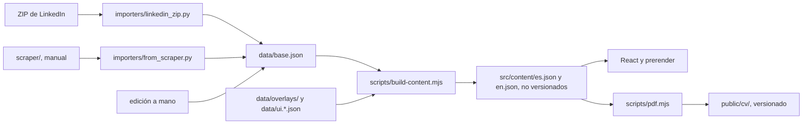

# cv-online

El CV de Guido Delponte como sitio estático: español en `/`, inglés en `/en`, con un PDF por idioma en `/cv/`.
Usa React 18, Vite 6 y Tailwind 3. Las páginas se prerenderizan a HTML y después se hidratan en el navegador.

Hace falta Node 20 o más nuevo y `npm ci` una vez. El importador usa Python 3 sin dependencias. Los PDF necesitan
Chrome instalado.

## Actualizar el CV desde un export nuevo de LinkedIn

Es el camino normal: no pide login ni scraper.

1. **Pedí el export.** En LinkedIn: Configuración y privacidad > Privacidad de datos > Obtener una copia de tus datos.
   Elegí el archivo completo, porque el importador necesita seis CSV y corta si falta uno: `Profile`, `Positions`,
   `Education`, `Certifications`, `Skills` y `Languages`.

2. **Guardá el ZIP fuera del repo.** Trae contactos y mensajes, y el repo es público. `.gitignore` ignora `*.zip` y
   `export/` por las dudas.

3. **Importalo.** Reescribe `data/base.json`:

   ```bash
   python importers/linkedin_zip.py "<ruta-al-export>.zip"
   ```

   Lee solo esos seis CSV y las columnas de `COLUMNS` en el script. La fecha del CV sale del nombre del ZIP
   (`..._MM-DD-YYYY`). Si el archivo se llama distinto, agregá `--data-date 2026-11`. Si el dato está incompleto, corta
   con error y no escribe nada.

4. **Mirá qué cambió:**

   ```bash
   git diff data/base.json
   ```

5. **Corré el guard** hasta que pase:

   ```bash
   npm run content
   ```

   Lista lo que encuentra y no genera nada hasta que esté resuelto. Las traducciones se controlan al final, así que
   pueden aparecer errores nuevos después de arreglar los primeros:

   | Mensaje | Qué hacer |
   |---|---|
   | `skill "X" is neither grouped nor in omit` | Sumalo a un grupo de `skillGroups` o a `omit` en `data/overlays/profile.json`. |
   | `bullet of "id" is neither tiered nor in omitBullets` | Ponelo en `bulletTiers.<id>.bullets` (se ve siempre), en `moreBullets` (dentro de "ver más") o en `omitBullets`, en `profile.json`. |
   | `tiered bullet ... is not in the export`, `omitBullets entry is not in the export`, `skill "X" is not in the export` | El texto cambió o ya no está: actualizá o borrá la entrada en `profile.json`. |
   | `bulletRewrites entry is not in the export` | LinkedIn cambió una viñeta. Actualizá su clave en `bulletRewrites` de `profile.json` y revisá el texto. |
   | `missing translation: "..."` | Agregá `{ "source": "<texto en español>", "en": "..." }` en `data/overlays/en.json`. |
   | `stale translation: "..."` | Ese texto en español ya no se usa: corregí el `source` o borrá la entrada. |
   | `position "id" has no company and no engagement label` | Agregá la etiqueta en `engagements` de `profile.json`. |
   | `end is null without current: true` | El puesto no trae fecha de fin y no figura como actual: revisá `data/base.json`. |
   | `end ... is before start`, `... is after the data date` | Fecha imposible: revisá `data/base.json` o LinkedIn. Solo una carrera puede terminar después de la fecha del export. |
   | `company must be text or null` | Empresa en blanco: poné `null` y la etiqueta en `engagements`. |
   | `language name: duplicate` | El idioma está dos veces: en el export y en `extraLanguages` de `profile.json`, o repetido. |

6. **Miralo en local:**

   ```bash
   npm run dev
   ```

   Abrí `http://localhost:5173/` y `http://localhost:5173/en`. Para ver el build, `npm run preview` sirve `dist/`, con
   `/en` igual que en producción (un middleware de `vite.config.js` lo reescribe a `en/index.html`).

7. **Generá los PDF y corré las compuertas.** Cada una tiene que terminar sin error:

   ```bash
   npm run lint
   npm test
   npm run pdf
   npm run build
   npm run pdf -- --check
   ```

   `npm run pdf` hace un build, imprime las dos páginas con Chrome contra un servidor local y escribe
   `public/cv/Guido-Delponte-CV-{es,en}.pdf` y `public/cv/manifest.json`. El segundo build vuelve a armar `dist/` con
   esos PDF.

   `--check` lee los PDF con `pdftotext` de [Poppler](https://poppler.freedesktop.org/), que tiene que estar en el PATH
   (Git for Windows lo trae en `mingw64/bin`, que PowerShell no tiene en el PATH por defecto). Controla títulos, todos los empleadores, viñetas separadas,
   los proyectos, `/Lang` y que sean 2 páginas o menos.

8. **Commiteá los datos y los PDF:**

   ```bash
   git add data public/cv
   git commit -m "chore(data): update the CV from the MM-YYYY export"
   ```

## Otras formas de actualizarlo

**Editar `data/base.json` a mano**, para un dato puntual. Tiene el mismo formato que deja el importador. Sigue en el
paso 5. El próximo import pisa este archivo: lo que cambies acá y no en LinkedIn se pierde en ese momento.

**Scraper, último recurso.** `npm run scrape` entra a LinkedIn con credenciales reales, y eso ya le hizo bloquear una
cuenta a Guido. Se corre solo a mano, nunca en CI ni programado. Ver [scraper/README.md](scraper/README.md).

## Textos que no vienen de LinkedIn

| Archivo | Qué tiene |
|---|---|
| `data/overlays/profile.json` | Contacto, URL del sitio, foto, `summary`, `headline`, etiqueta de cada puesto sin empresa, grupos de skills, `projects`, certificaciones destacadas, qué viñetas se muestran y cuáles se omiten, sus textos reescritos (`bulletRewrites`), niveles de idioma. También `extraLanguages`: `Español / Nativo` no está en el export (`Languages.csv` solo trae inglés) y ningún guard lo ata a una fuente. |
| `data/overlays/en.json` | Traducciones, una entrada `{ source, en }` por texto. |
| `data/ui.es.json`, `data/ui.en.json` | Textos de la interfaz. Los dos tienen que tener las mismas claves. |

`projects` es una lista cerrada: un repo aparece en el sitio y en el PDF solo si está escrito ahí. El guard exige que la
URL sea `https://github.com/GDelpo/<id>`, sin nada detrás. Con la lista vacía, la sección no se muestra.

El guard solo controla que cada traducción corresponda al texto en español actual, no que esté bien. El campo `status`
de `en.json` dice `draft-review-by-guido`: son un borrador hasta que Guido las revise. Los títulos de cursos y
certificaciones quedan en su idioma original en `/en`: es el nombre con el que se emitieron y el que muestra el enlace a
la credencial.

## Cómo se arma



`npm run build` corre, en orden: `build-content`, `vite build`, el build SSR de `src/entry-server.jsx`,
`scripts/prerender.mjs` y `scripts/verify-dist.mjs`. La salida es `dist/`.

`verify-dist` falla el build si algo de esto no da:

- `lang`, un solo `h1`, y en el HTML tantos puestos, certificaciones, estudios y proyectos como tiene el contenido, más
  el mapa en sus 4 formas. Canonical y hreflang en cada página.
- Ningún título de sección en español en `/en`, y ningún `dangerouslySetInnerHTML` en `src/`.
- `public/cv/manifest.json` coincide con el sha256 de `src/content/{es,en}.json`. Si cambió el contenido y no se
  regeneraron los PDF, no hay build.
- Presupuestos en gzip: JS 75 KB, CSS 12 KB, cada JSON de idioma 10 KB, fuentes 91 KB, foto 30 KB.

`SKIP_PDF_CHECK=1` saltea el control del manifest. Lo usa `npm run pdf` para su build interno; un build hecho así no se
publica.

El CV impreso es un árbol aparte, `src/components/PrintCV.jsx`, que el navegador monta oculto después de hidratar y solo se ve al imprimir:
una columna, sin foto y con todo desplegado. Sus estilos están al final de `src/index.css`.

Los colores y las fuentes son las variables CSS de `src/index.css`, mapeadas en `tailwind.config.js`. La paleta de
Tailwind está reemplazada por esos tokens, así que otro color no tiene clase. `tests/contrast.test.js` lee esas variables
y calcula el contraste de cada par en los dos temas: 4.5:1 para texto, 3:1 para líneas.

### El mapa

El mapa del encabezado no está dibujado a mano. `layoutTransitMap` en `src/lib/transitMap.js` es una función pura: recibe
puestos, estudios y grupos de skills, y devuelve coordenadas. Un puesto nuevo en `base.json` entra solo, sin tocar código:

- Los años van a escala. La excepción es un puesto recién empezado, que espera en el borde de la foto para no taparla.
- Dos puestos que se superponen en el tiempo van en líneas paralelas. Uno que empieza cuando termina otro usa su misma
  línea.
- El puesto actual más nuevo es la línea bermellón.
- Cada grupo de skills es un ramal que sale de la foto. En el celular se pliegan en un solo enlace.

Hay cuatro formas (`wide`, `mid`, `tablet`, `phone`) y el HTML trae las cuatro. El CSS muestra la que entra, así que el
mapa se ve sin JavaScript. `tests/transit-map.test.js` prueba cada forma con 3, 4, 5 y 6 puestos y con `company` en
`null`: ninguna etiqueta pisa a otra ni a una línea. Las listas de abajo repiten todo el texto del mapa.

```
data/            base.json, overlays y textos de la interfaz (la fuente del contenido)
importers/       importadores del export y del scraper, con sus tests
scraper/         aislado, solo manual
scripts/         build-content, prerender, verify-dist, pdf
public/          404, robots, favicon, og.jpg, img/, cv/
src/App.jsx      orden de la página
src/components/  un archivo plano por sección
src/lib/         fechas, tema, tipos JSDoc y la geometría del mapa
src/content/     generado, no versionado
tests/           Vitest
```

## Tests

```bash
npm test
python -m unittest discover importers/tests
```

Los del importador usan fixtures sintéticos, nunca un export real.

## Deploy

`vercel.json` configura Vercel: corre `npm run build` y publica `dist/`, sin rewrite de SPA, así que una URL
desconocida devuelve `404.html` con status 404. `/assets/*` lleva cache inmutable.

Vercel solo necesita Node, porque `build-content` corre ahí y los PDF ya vienen commiteados. Por eso van generados antes
de pushear: con PDF viejos, `verify-dist` frena el deploy.

[PENDIENTE - todavía no se probó contra un preview de Vercel. Con la URL del preview:]

```bash
curl -I <url>/en      # 200, sin loop de redirects
curl -I <url>/nope    # 404
```

Y en view-source de `/en` tiene que haber contenido y `lang="en"`.
