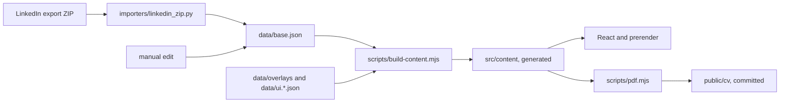

# cv-online

The source of my CV: a static site in Spanish and English, plus a PDF per language, generated from the official
LinkedIn data export. The build fails if the data is incomplete or the published pages and PDFs don't match it.

**Live:** [Spanish](https://cv-online-puce.vercel.app) · [English](https://cv-online-puce.vercel.app/en) ·
[PDF (ES)](https://cv-online-puce.vercel.app/cv/Guido-Delponte-CV-es.pdf) ·
[PDF (EN)](https://cv-online-puce.vercel.app/cv/Guido-Delponte-CV-en.pdf)

[](https://cv-online-puce.vercel.app/en)

**Stack:** React 18, Vite 6 and Tailwind 3, prerendered to HTML and hydrated in the browser. Python 3 importer with no
dependencies. Playwright and Chrome for the PDFs. Vitest and `unittest` for tests. Deployed on Vercel.

## What's in it

**Data with guards.** The importer reads six CSV files from the export and stops without writing anything if a column
or a value is missing. `scripts/build-content.mjs` then merges that data with the hand-written overlays and refuses to
generate content if a skill has no group, a bullet has no tier, a translation is missing or stale, or a date is
impossible.

**A build that checks its own output.** `scripts/verify-dist.mjs` fails the build on missing sections, a wrong `lang`,
canonical or hreflang, Spanish headings in `/en`, or a bundle over its gzip budget. PDFs are committed with the SHA-256
of the content they came from, so stale PDFs block the deploy.

**A generated map.** The header map isn't drawn by hand. `layoutTransitMap` in `src/lib/transitMap.js` is a pure function
that turns jobs, studies and skill groups into coordinates, so a new job needs no code change. The HTML carries all four
responsive layouts and CSS picks one, which means the map renders without JavaScript. Tests run every layout with 3 to 6
jobs and check that no label overlaps another label or a line.

**ATS-friendly PDFs.** Printing uses a separate tree, `src/components/PrintCV.jsx`: one column, no photo, everything
expanded. `npm run pdf -- --check` reads the text back with `pdftotext` and checks titles, employers, bullets, projects,
`/Lang` and a limit of 2 pages.

**Accessible colors by test.** `tests/contrast.test.js` reads the CSS variables and computes the contrast of each pair in
both themes: 4.5:1 for text, 3:1 for lines.

## How it fits together



## Run it

Requires Node 20 or newer. The PDFs also need Chrome, and their check needs Poppler's `pdftotext`.

```bash
npm ci
npm run dev        # http://localhost:5173/ and /en
npm run lint
npm test
npm run test:py    # importer tests, with synthetic fixtures
npm run build
```

## Docs

[docs/updating.md](docs/updating.md) covers how to update the CV from a new export, what each guard error means, the
build steps and the deploy.

`scraper/` is a browser scraper from before the export became the data source. It logs in with real credentials, which
LinkedIn's terms forbid, and it got an account blocked. I keep it isolated and manual only, and I don't recommend it:
see [scraper/README.md](scraper/README.md).

## License

The code is under the [MIT License](LICENSE). It doesn't cover my personal content: the CV data in `data/`, the PDFs in
`public/cv/`, and the photo and images in `public/img/` and `public/og.jpg`. If you reuse this, put your own in.
