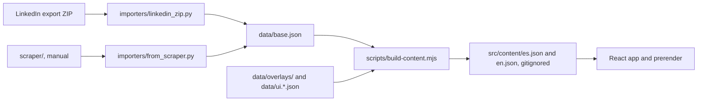

# cv-online

Guido Delponte's CV as a static site: Spanish at `/`, English at `/en`. Built with React 18, Vite 6 and Tailwind 3,
prerendered to plain HTML and hydrated in the browser.

## Run it

Requires Node 20 or newer.

```bash
npm ci
npm run dev       # generates src/content, then starts Vite
npm run lint
npm test          # generates src/content, then runs Vitest
npm run test:py   # importer tests, synthetic fixtures only
```

## Build

```bash
npm run build
```

`build` runs, in order: `scripts/build-content.mjs`, `vite build`, the SSR build of `src/entry-server.jsx`,
`scripts/prerender.mjs` and `scripts/verify-dist.mjs`. The output is `dist/`.

`verify-dist` fails the build when the pages, the size budgets or the PDF manifest are wrong. [PENDING - the PDF
generator is not in the repo yet, so until it is, a build only passes with the manifest check skipped:]

```bash
SKIP_PDF_CHECK=1 npm run build
```

A build made that way must not be deployed: its "Download PDF" links have no files behind them.

## Where the content comes from

The page text is not written in the components. It flows from committed data to generated JSON:



To update the CV from a new export (the ZIP stays outside the repo):

```bash
npm run import:linkedin -- <path-to-export.zip>
npm run content
```

`build-content` is the guard. It stops `dev`, `test` and `build` on a missing required field, a translation that no
longer matches its Spanish source, mismatched UI keys, or a skill or bullet from the export that was neither placed nor
explicitly omitted. Fix those in `data/overlays/profile.json` and `data/overlays/en.json`.

## Layout

```
data/            base.json, overlays and UI strings (the source of the content)
importers/       LinkedIn export and scraper importers, with their tests
scraper/         isolated, manual only; see scraper/README.md
scripts/         build-content, prerender, verify-dist
public/          404, robots, favicon, og.jpg, img/
src/App.jsx      page order
src/components/  one flat file per section
src/lib/         date formatting, theme switch, JSDoc types
src/content/     generated, gitignored
tests/           Vitest
```

Colors and fonts are the CSS variables in `src/index.css`, mapped in `tailwind.config.js`. The Tailwind palette is
replaced by those tokens, so other colors have no class to use.

## Deploy

Vercel, configured in `vercel.json`: static output, no SPA rewrite, so unknown URLs get `404.html` with a 404 status.
