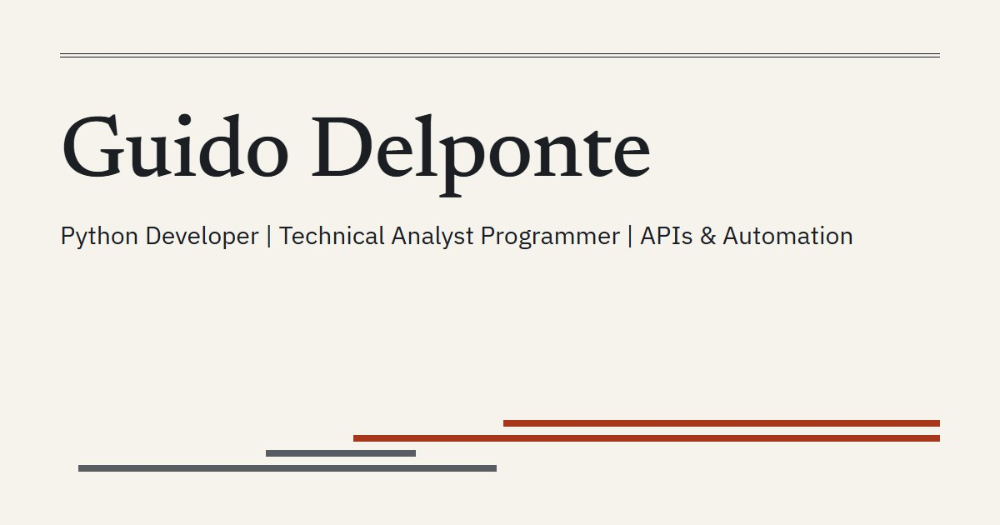
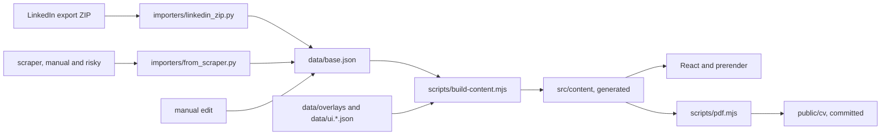

# cv-online

The source of my CV: a static site in Spanish and English, plus a PDF per language, generated from the official
LinkedIn data export. The build fails if the data is incomplete or the published pages and PDFs don't match it.

**Live:** [Spanish](https://guido.is-a.dev) · [English](https://guido.is-a.dev/en) ·
[PDF (ES)](https://guido.is-a.dev/cv/Guido-Delponte-CV-es.pdf) ·
[PDF (EN)](https://guido.is-a.dev/cv/Guido-Delponte-CV-en.pdf)

[](https://guido.is-a.dev/en)

**Stack:** React 18, Vite 6 and Tailwind 3, prerendered to HTML and hydrated in the browser. Python 3 importer with no
dependencies. Playwright and Chrome for the PDFs. Vitest and `unittest` for tests. Deployed on Vercel.

## What's in it

**Data with guards.** The importer reads six CSV files from the export and stops without writing anything if a column
or a value is missing. `scripts/build-content.mjs` then merges that data with the hand-written overlays and refuses to
generate content if a skill has no group, a bullet has no tier, a translation is missing or stale, or a date is
impossible.

**A build that checks its own output.** `scripts/verify-dist.mjs` fails the build on missing sections, a wrong `lang`,
canonical or hreflang, Spanish headings in `/en`, or a bundle over its gzip budget. PDFs are committed with the SHA-256
of the content they came from, so stale PDFs block the deploy.

**A generated map.** The header map isn't drawn by hand. `layoutTransitMap` in `src/lib/transitMap.js` is a pure function
that turns jobs, studies and skill groups into coordinates, so a new job needs no code change. The HTML carries all four
responsive layouts and CSS picks one, which means the map renders without JavaScript. Tests run every layout with 3 to 6
jobs and check that no label overlaps another label or a line.

**One-page, ATS-friendly PDFs.** Printing uses a separate tree, `src/components/PrintCV.jsx`: one column, no photo. The
site shows every bullet, while the PDF prints a subset chosen in the data: a few bullets per recent role and a one-line
summary for older ones. `npm run pdf -- --check` reads the text back with `pdftotext` and checks titles, employers, the
printed bullets, projects, `/Lang` and a limit of 1 page.

**Accessible colors by test.** `tests/contrast.test.js` reads the CSS variables and computes the contrast of each pair in
both themes: 4.5:1 for text, 3:1 for lines.

## How it fits together



## Two ways to load your data

**1. The official export (recommended).** Download your data archive from LinkedIn and import the ZIP. It needs no login
from this code and carries no risk for your account. The export doesn't include everything, such as your English profile
or courses, so the rest goes in the overlays.

```bash
python importers/linkedin_zip.py "<path-to-export>.zip"
npm run content
```

Keep the ZIP outside the repo: it contains your contacts and messages.

**2. The scraper (at your own risk).**

> [!CAUTION]
> **LinkedIn can restrict or ban your account for this. It already got one of mine blocked.** The scraper logs in with
> your real credentials and drives a browser, which LinkedIn's terms forbid. Run it only by hand, never in CI or on a
> schedule.

It's useful when you need something the export lacks. The build and CI don't run it, and only its mapping to
`data/base.json` has tests, so it can break when LinkedIn changes its pages. Setup is in
[scraper/README.md](scraper/README.md).

```bash
pip install -r scraper/requirements.txt
cp scraper/.env.example scraper/.env    # then fill in the values
npm run scrape
npm run content
```

## Run it

Requires Node 20 or newer. The PDFs also need Chrome, and their check needs Poppler's `pdftotext`.

```bash
npm ci
npm run dev        # http://localhost:5173/ and /en
npm run lint
npm test
npm run test:py    # importer tests, with synthetic fixtures
npm run build
```

## Docs

[docs/updating.md](docs/updating.md) covers how to update the CV from a new export, what each guard error means, the
build steps and the deploy.

## License

The code is under the [MIT License](LICENSE). It doesn't cover my personal content: the CV data in `data/`, the PDFs in
`public/cv/`, and the photo and images in `public/img/` and `public/og.jpg`. If you reuse this, put your own in.
